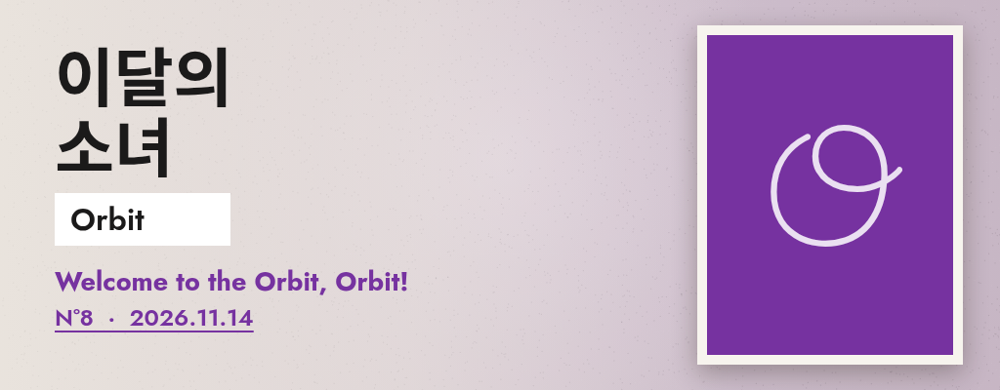

<div align="center">

# Heekki 🌙

**A LOONA-themed Discord bot: music, welcome cards, games, member profiles and handy lookups.**




<sub>A welcome card, drawn by the bot in LOONA's twelve member colours.</sub>

</div>

---

## Contents

- [Features](#features)
- [Getting started](#getting-started)
- [Configuration](#configuration)
- [Commands](#commands)
- [How things work](#how-things-work)
- [Project layout](#project-layout)
- [Credits](#credits)

## Features

| | |
|---|---|
| **Music** | YouTube and Spotify through Lavalink v4, search-and-pick, queue, seek, volume, loop, filters (8D, nightcore, karaoke, bassboost...). Stays in the call until it's been alone for 3 minutes. |
| **Last.fm** | Now playing, recent scrobbles, top lists, album collages up to 10x10, artist/album info, who knows an artist/track/album, crowns, and taste matches. |
| **Welcome cards** | The "twelve stars" card for joins and leaves, with your own message, background and star colours. |
| **LOONA** | Profiles for all 12 members with photos, fun facts, official colours and birthdays, plus a post in your greeting channel on each birthday. |
| **Fun & games** | LOONA slot machine, tic-tac-toe, rock paper scissors, trivia, memes, ratings, snipe and text toys. |
| **Info** | Member, server, role and channel info, plus anime, GitHub, news, Pokédex, Steam, weather and Wikipedia lookups. |
| **Prefix or slash** | Every command works as `-play` **and** `/play`. The prefix can be changed per server. |

## Getting started

**You need:** Node.js 22.13+, Docker (for the Lavalink music server) and a [Neon](https://neon.com) project (database and file storage).

**1. Set up the bot in the [Discord Developer Portal](https://discord.com/developers/applications)**
- Under **Bot**, turn on **Message Content Intent** and **Server Members Intent**. Discord refuses the login without them.
- Invite it with the `bot` and `applications.commands` scopes and these permissions: View Channels, Send Messages,
  Send Messages in Threads, Embed Links, Attach Files, Read Message History, Connect, Speak.

**2. Add your secrets**
```bash
cp .env.example .env    # then fill in DISCORD_TOKEN, YT_CIPHER_PASSWORD (any long random string) and optionally Spotify
```

**3. Connect the database**

Settings, Last.fm links, crowns and coins live in Neon Postgres; greeting backgrounds live in Neon Object Storage
(the `assets` bucket in `neon.ts`).
```bash
npm i -g neon@latest
neon deploy             # signs you in, creates the bucket, and adds DATABASE_URL and the AWS_* storage keys to .env
```
The bot creates its tables itself on first start.

**4. Start the music server**
```bash
docker compose up -d    # Lavalink + the YouTube cipher helper; the first start takes ~30 s
```

**5. Sign Lavalink in to YouTube (one time)**

YouTube blocks most playback for signed-out servers. Use a **spare Google account**, never your main one.
```bash
docker compose logs lavalink | grep google.com/device   # open that page and enter the code
docker compose logs lavalink | grep "Token retrieved"    # copy the 1//... value into .env as YOUTUBE_REFRESH_TOKEN
docker compose up -d --force-recreate                     # now it stays signed in
```

**6. Run the bot**
```bash
npm install
npm start               # `npm run build` syntax-checks every file first, if you like
```

## Configuration

Secrets live only in `.env`; everything else is in `config.js`.

| `.env` setting | What it's for |
|---|---|
| `DISCORD_TOKEN` | Your bot's token |
| `LAVALINK_PASSWORD` | Shared by the bot and the Lavalink container (change it in this one place) |
| `YT_CIPHER_PASSWORD` | Between Lavalink and the YouTube cipher helper; any long random string |
| `YOUTUBE_REFRESH_TOKEN` | The spare account's YouTube sign-in (step 5) |
| `DATABASE_URL` | Neon Postgres connection string (added by `neon deploy`) |
| `AWS_ACCESS_KEY_ID`, `AWS_SECRET_ACCESS_KEY`, `AWS_ENDPOINT_URL_S3`, `AWS_REGION` | Neon Object Storage keys for greeting backgrounds (added by `neon deploy`) |
| `SPOTIFY_ENABLED`, `SPOTIFY_CLIENT_ID`, `SPOTIFY_CLIENT_SECRET` | Optional: Spotify links and search |
| `LASTFM_API_KEY` | Optional: the Last.fm commands ([free key](https://www.last.fm/api/account/create)) |

## Commands

The default prefix is `-` (change it per server with `-setprefix`). `<x>` is required, `[x]` is optional.
Run `help` in Discord for the same list with usage details.

<details>
<summary><b>Music</b>: play, queue, filters</summary>

| Command | What it does | Aliases |
|---|---|---|
| `8d` | Changes the filter of the song to 8D. |  |
| `bassboost [level]` | Bassboost's the current song with a given level. | `bb` |
| `filteroff` | Removes the filters provided. | `removefilter` |
| `karaoke` | Changes the filter of the song to Karaoke. | `instrumental` |
| `loop [mode]` | Loops the current song. | `repeat` |
| `nightcore` | Changes the filter of the song to nightcore. | `alvin` |
| `nowplaying` | Shows the current song being played. | `np` |
| `pause` | Pauses the current track. |  |
| `play <query>` | Plays a requested song. | `p` |
| `queue [page]` | Shows the current queue of songs. | `q` |
| `resume` | Resumes the current track. |  |
| `seek <seconds>` | Seeks the current playing music. |  |
| `skip [number]` | Skips the current track, or a chosen song in the queue. | `skp` `skipper` |
| `stop` | Stops the current song. | `stp` `s` |
| `treblebass` | Changes the filter of the song to treblebass. |  |
| `volume [level]` | Changes the volume of the player. | `vol` |

</details>

<details>
<summary><b>Last.fm</b>: scrobbles, charts, who knows, crowns</summary>

Link your account once with `fmset <username>`; it works in every server. Periods: `week` (default), `month`, `3months`, `6months`, `year`, `alltime`.
Commands that take an artist, track or album use what you're playing when you leave it empty. Tracks and albums are written `Artist - Title`.

| Command | What it does | Aliases |
|---|---|---|
| `album [album]` | Info about an album on Last.fm, with your plays and your rank in this server. | `ab` |
| `artist [artist]` | Info about an artist on Last.fm, with your plays and your rank in this server. | `a` |
| `collage [size] [period] [titles] [playcounts] [user]` | A picture of your top albums (3x3 by default, up to 10x10; `notitles`, `plays`). | `fmc` `chart` `c` |
| `crowns [user]` | The artist crowns someone holds in this server (win them with whoknows). | `cw` |
| `fm [user]` | Shows what you (or someone) are listening to on Last.fm right now. | `lastfm` `fmnp` |
| `fmset <username>` | Links your Last.fm account so the fm commands know who you are. | `fmlogin` |
| `fmtop [type] [period] [user]` | Your top 10 artists, tracks or albums on Last.fm for a time period. | `fmt` |
| `fmunset` | Unlinks your Last.fm account from the bot. | `fmlogout` |
| `recent [user]` | Your last 10 scrobbles on Last.fm. | `rc` |
| `taste <user> [period]` | Compares your top artists on Last.fm with someone else's. | `compare` |
| `whoknows [artist]` | Who in this server listens to an artist the most (the top listener holds its 👑 crown). | `wk` |
| `wka [album]` | Who in this server listens to an album the most. | `whoknowsalbum` |
| `wkt [track]` | Who in this server listens to a song the most. | `whoknowstrack` |

**Crowns:** the top listener of an artist in a server holds its crown. Crowns are checked whenever someone runs
`whoknows` or `artist`, and only change hands when someone has strictly more plays (a tie, or a lookup Last.fm
couldn't answer, keeps the current holder).

</details>

<details>
<summary><b>LOONA</b>: member profiles</summary>

| Command | What it does | Aliases |
|---|---|---|
| `loona [member]` | LOONA member profiles with photos and fun facts. | `orbit` `member` |

</details>

<details>
<summary><b>Fun & Games</b>: slots, games, toys</summary>

| Command | What it does | Aliases |
|---|---|---|
| `8ball <question>` | Ask the magic 8-ball a yes/no question. | `eightball` |
| `coinflip` | Flip a coin. | `flip` `coin` |
| `cuterate [user]` | How cute is someone today? (changes daily) | `cute` |
| `decode <text>` | Decodes binary or base64 text. |  |
| `dumbrate [user]` | How dumb is someone today? (changes daily) | `dumb` |
| `emojify <text>` | Turns your text into big emoji letters. |  |
| `enchant <text>` | Writes your text in Minecraft enchanting-table letters. |  |
| `fliptext <text>` | Flips your text upside down. | `upsidedown` |
| `hack <user>` | Pretend to hack someone (a harmless joke). |  |
| `love-calculator <user> [other]` | How compatible are two members? (changes daily) | `love` `ship` |
| `meme [source]` | A random meme from r/kpopmemes or r/LOONA. |  |
| `motivation` | A little encouragement. | `motivate` |
| `roll [dice]` | Roll dice, like 2d6 or d20 (default: one 6-sided die). | `dice` |
| `rps [opponent]` | Rock paper scissors against the bot, or challenge a member. | `rockpaperscissors` |
| `slots [bet]` | Spin the LOONA slot machine with moon coins (12 member animals + the moon jackpot). | `slot` |
| `smartrate [user]` | How smart is someone today? (changes daily) | `smart` |
| `snipe` | Shows the last deleted message in this channel (from the last 15 minutes). |  |
| `snipeedit` | Shows what the last edited message said before the edit in this channel (from the last 15 minutes). | `esnipe` |
| `tictactoe <opponent>` | Challenge another member to tic-tac-toe. | `ttt` |
| `trivia` | A trivia question: first person to click the right answer wins. | `quiz` |
| `zalgo <text>` | Makes your text look cursed. | `cursed` |

</details>

<details>
<summary><b>Greetings</b>: welcome cards (Manage Server only)</summary>

| Command | What it does | Aliases |
|---|---|---|
| `greet-settings` | Shows the current greeting settings. | `greetsettings` |
| `set-greet-bg (image) [link_or_reset]` | Sets the greeting card background from an uploaded image (or "reset"). | `greetbg` |
| `set-greet-channel <channel>` | Sets the channel where welcome and leave greetings are posted. | `greetchannel` |
| `set-greet-colors <colors>` | Sets the 12 star colours on the greeting card (or "reset" for the LOONA colours). | `greetcolors` |
| `set-join-message <message>` | Sets the join greeting text. Placeholders: {user} {username} {server} {count} |  |
| `set-leave-message <message>` | Sets the leave greeting text. Placeholders: {user} {username} {server} {count} |  |
| `testjoin` | Previews the join greeting here, using you as the member. |  |
| `testleave` | Previews the leave greeting here, using you as the member. |  |
| `toggle-birthday-posts` | Switches LOONA member birthday posts in the greeting channel on or off. | `togglebirthdays` |
| `toggle-join-greet` | Switches the join greeting on or off. |  |
| `toggle-leave-greet` | Switches the leave greeting on or off. |  |

</details>

<details>
<summary><b>Info</b>: members, server and lookups</summary>

| Command | What it does | Aliases |
|---|---|---|
| `anime <title>` | Looks up an anime on AniList. |  |
| `channelinfo [channel]` | Shows info about a channel (this one by default). | `ci` |
| `github <username>` | Shows a GitHub profile. | `gh` |
| `globalwhois <user>` | Shows info about any Discord user by ID, even outside this server. | `gwhois` |
| `invites [user]` | Who invited the most people (or how many someone invited). |  |
| `news [topic]` | Latest news headlines (LOONA by default). |  |
| `pokedex <pokemon>` | Looks up a Pokémon by name or number. | `pokemon` `dex` |
| `roleinfo <role>` | Shows info about a role. | `ri` |
| `rolememberinfo <role>` | Lists the members who have a role. | `inrole` `rolemembers` |
| `serverinfo` | Shows info about this server. | `server` `si` |
| `stats` | Shows the bot's stats. | `botinfo` |
| `steam <game>` | Looks up a game on the Steam store. |  |
| `uptime` | How long the bot has been online. |  |
| `urbandictionary <term>` | Looks up a word on Urban Dictionary (age-restricted channels only). | `urban` `ud` |
| `userbanner [user]` | Shows someone's profile banner. | `banner` |
| `weather <place>` | Current weather for a city (Open-Meteo). |  |
| `whois [user]` | Shows info about a member of this server. | `userinfo` `ui` |
| `wikipedia <topic>` | Summarizes a Wikipedia article. | `wiki` |

</details>

<details>
<summary><b>Utilities</b>: help and settings</summary>

| Command | What it does | Aliases |
|---|---|---|
| `help [command]` | Shows what the bot can do, or details on one command. | `h` |
| `musichelp` | Provides a guide for music settings. | `musich` |
| `ping` | Shows the bot's websocket ping. |  |
| `setprefix [prefix]` | Sets a specific prefix for your server. | `sp` |

</details>

## How things work

<details>
<summary><b>Welcome cards</b></summary>

New members get the twelve-stars card plus your message. Placeholders: `{user}` (mention), `{username}`, `{server}`, `{count}`.
Join is on and leave is off by default, and nothing posts until `set-greet-channel` is set. `testjoin` / `testleave`
preview in the current channel and say if anything would stop the real greeting. Backgrounds must be Discord uploads or
Discord image links (PNG/JPEG/WebP, up to 8 MB); the bot needs **Attach Files** in the greeting channel.

On each member's birthday (midnight Korea time, checked hourly) the greeting channel also gets her profile with a
birthday line. It's on by default and posts once per member per year; `toggle-birthday-posts` switches it off.
</details>

<details>
<summary><b>LOONA profiles</b></summary>

`loona` shows the group page (including whose birthday is next) and a menu of all 12 members. `loona <name>` opens a profile;
names, Korean names and nicknames all work (`heekki`, `희진`, `olivia hye`). Buttons flip through photos and facts.
The data is a snapshot in `lib/loona/members.json`.
</details>

<details>
<summary><b>Slots</b></summary>

Spins the 12 member animals plus the moon jackpot: any pair pays ×3, three of a kind ×40, three moons ×150
(about 93% paid back over time). Moon coins are per server; everyone starts with 500 and gets 100 back when broke.
</details>

<details>
<summary><b>Voice, snipe and safety</b></summary>

- When the queue ends, the bot stays in the voice channel and leaves after being alone for 3 minutes (`ALONE_LEAVE_MS` in `events/voiceStateUpdate.js`). `stop` leaves right away.
- `snipe` / `snipeedit` remember only the last deleted or edited message per channel, in memory, for 15 minutes.
- Text that users or websites provide never pings anyone, and `urbandictionary` only works in age-restricted channels.
</details>

## Project layout

```
commands/<category>/   one file per command (the folder name is its help category)
events/                Discord event handlers: messages, slash commands, joins/leaves, voice
handler/               loads commands and runs slash commands through the same code as prefix ones
lib/                   shared code: db.js (Neon Postgres), storage.js (Neon Object Storage), fun/, greetings/, info/, loona/
lavalink/              music server config, started by docker-compose.yml
assets/fonts/          the font used on welcome cards
docs/                  design notes and images
test/                  run with `npm test`
```

## Credits

- **LOONA profiles and facts:** [LOONA Wiki](https://loonatheworld.fandom.com), CC BY-SA.
- **Photos:** freely licensed photos from [Wikimedia Commons](https://commons.wikimedia.org); the photographer and licence are shown under each one.
- **Font:** [Noto Sans KR](https://fonts.google.com/noto/specimen/Noto+Sans+KR), SIL Open Font License (`assets/fonts/OFL.txt`).
- **Lookups:** AniList, GitHub, Google News, PokeAPI, Steam, Open-Meteo, Wikipedia and Urban Dictionary.

<div align="center"><sub>Made for Orbits by Orbits.</sub></div>
